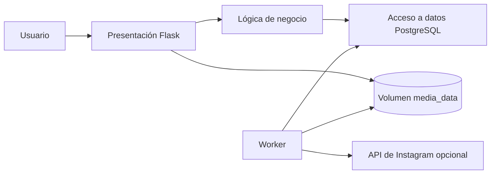

# Laboratorio 5 — Pregunta 2: campaña desde una foto

Aplicación sencilla para una práctica académica. Recibe una foto, propone tres guiones, permite elegir uno y genera tres imágenes y un video MP4 de nueve segundos. La generación ocurre en un proceso aparte para que guardar no deje esperando al navegador.

El servidor web usa hilos para recibir fotos en conexiones lentas sin que Gunicorn mate el proceso durante la carga. Si el archivo supera 8 MB se muestra un mensaje claro.

## Arquitectura

**Flujo:** el navegador envía una foto y los datos de la empresa. Se guardan en PostgreSQL y en el volumen. La lógica propone tres guiones. Al elegir uno, la solicitud queda en una cola de la base; `worker` produce tres imágenes JPG y el video MP4. La página consulta el estado cada 2,5 segundos y muestra los archivos cuando están listos. Si se configura la API de Instagram, el mismo trabajador puede publicar el video como Reel.

## Ejecutar localmente

1. Copiar `.env.example` como `.env` y cambiar `POSTGRES_PASSWORD`.
2. Ejecutar `docker compose up --build -d` en esta carpeta.
3. Abrir `http://localhost:8001`.
4. Para revisar servicios: `docker compose ps`. Para detener sin borrar datos: `docker compose down`.

Los volúmenes `postgres_data` y `media_data` conservan campañas y archivos. `docker compose down -v` los elimina.

## Variables

`APP_PORT` es el puerto local; `POSTGRES_USER`, `POSTGRES_PASSWORD` y `POSTGRES_DB` configuran PostgreSQL; `PUBLIC_BASE_URL` es la URL pública con HTTPS cuando se publica en Instagram; `IG_USER_ID` e `IG_ACCESS_TOKEN` son las credenciales de la API oficial; `PUBLISH_PIN` limita quién puede pulsar «Publicar Reel». Mantener `.env` fuera del repositorio.

## Instagram

La cuenta personal se puede usar para **publicar manualmente** el video descargado. Para publicación automática mediante la API oficial de Meta se requiere una cuenta profesional (Creador o Empresa), una app de Meta con el permiso de publicación, un token válido y una URL HTTPS pública del video. Una vez configuradas las variables, el botón «Publicar Reel» envía el trabajo al worker, que consulta el estado de procesamiento y guarda el ID de la publicación. Si Meta rechaza la solicitud, el motivo aparece en pantalla.

## Despliegue

Publicar la imagen en GHCR y usar una máquina EC2 con Docker y Docker Compose. Clonar este repositorio, definir `.env`, abrir el puerto web y ejecutar `docker compose up --build -d`. El archivo Compose incluye la aplicación, el worker y la base de datos. Para la API de Instagram, servir la app y el video mediante HTTPS y fijar esa dirección en `PUBLIC_BASE_URL`.

### Despliegue realizado

- AWS `us-east-1`, instancia EC2 `i-0036d5352905ddc10`, tipo `t3.small`.
- Aplicación comprobada: `http://ec2-44-200-3-4.compute-1.amazonaws.com:8001`.
- Grupo de seguridad: `sg-04773258a1ec93386`, con el puerto 8001 abierto para la demostración.
- Instalador: [deploy/aws-user-data.sh](deploy/aws-user-data.sh). Genera la contraseña de PostgreSQL y el PIN en la propia instancia.
- Imagen publicada: `ghcr.io/miguel-acd/el3302-lab5-marketing:1.0`. La instancia construye el mismo código desde este repositorio porque el paquete de GHCR puede requerir autenticación.
- Verificación: carga de foto, elección de guion, tres imágenes y video completaron con estado `ready` tanto en local como en EC2.

La IP y el nombre DNS pueden cambiar si se detiene la instancia. La instancia y el almacenamiento pueden generar cargos mientras sigan activos.

## Evidencias

Dockerfile, Compose y variables sin secretos; servicios activos; formulario con foto; tres guiones; guion elegido; estado de generación; tres imágenes; video en reproducción; filas de PostgreSQL; persistencia tras reiniciar; imagen en registro; app en AWS; publicación real en Instagram si se logra configurar la cuenta profesional y Meta.
